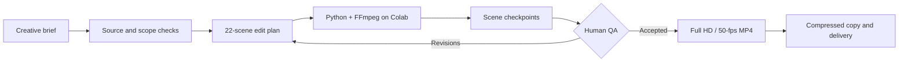

# AI-Assisted Video Production & Workflow Automation

**A completed personal project presented as an AI Project Management and process-automation case study.**

**Focus:** AI Project Management · Workflow Design · Human-in-the-Loop Automation · Quality Assurance · Python / FFmpeg / Google Colab  
**Project period:** October 2026  
**Case:** *Legend of the Seas* — an **unofficial, independent fan tribute**, not commissioned, approved, or endorsed by Royal Caribbean.

> **Portfolio headline:** Designed and guided an AI-assisted, checkpointed video-production process from an evolving creative brief to an owner-accepted **Full HD / 50-fps** music video. The project demonstrates AI-assisted coordination, deterministic media rendering, and human quality control — not model training or an existing SaaS.

## At a glance

| Result / scope | Details | Evidence |
| --- | --- | --- |
| Deliverable | Completed personal music video | Owner's confirmation |
| Duration | **157.368 seconds** | Documented edit plan; final-file probe not archived |
| Export | **1920 × 1080, 50 fps**, MP4 | Configured render and owner review |
| Production | **22 segments**, **15 approved source windows** | Workflow specification |
| Sharing | Compact MP4 of approximately **140 MB** | Owner report |
| Further outcome | Initial Royal Caribbean outreach sent; reaction or endorsement unknown | Owner report |
| Cost, hours and ROI | **Not measured** | No numerical claim |

## Challenge

Create a professional-looking video from a self-recorded vocal performance and selected large source recordings while minimizing manual timeline editing. Enforce precise source windows, avoid wrong ship/destination imagery, repair frame and image quality issues, and deliver an easy-to-share file without downloading entire multi-gigabyte sources.

## My role: AI project manager and workflow designer

I specified creative and technical requirements, approved source windows, recorded the vocal track, reviewed early cuts, prioritized fixes, coordinated AI-assisted code and workflow design, and accepted the output. **ChatGPT assisted with planning, troubleshooting, and code generation; Python and FFmpeg ran media operations in Google Colab. Human review governed the editorial choices.**

## Production workflow



### Problems solved

- **Scope control:** kept visuals inside approved footage windows, featuring the ship and Perfect Day at CocoCay.
- **Quality:** eliminated unwanted cards and enlarged/blurred scenes, corrected title placement and transition issues.
- **Smoothness:** progressed from 540p preview edits to a source-based Full HD rebuild.
- **Reliability:** saved scene checkpoints in Google Drive so interruptions did not require all scenes to be recreated.
- **Delivery:** prepared a compact MP4 and distinguished Google Drive streaming playback from the downloadable original.

## Portfolio documents

- [Detailed professional case study — English](docs/CASE_STUDY.md)
- [Architecture and QA gates](docs/ARCHITECTURE.md)
- [Evidence and results](docs/EVIDENCE.md)
- [Media rights, privacy and scope](docs/RIGHTS_AND_SCOPE.md)
- [Commercial application ideas](docs/PRODUCT_OPPORTUNITY.md)
- [Runnable rights-clean FFmpeg mini-demo](demo/README.md)
- [Русская версия / Russian version](README_RU.md)

## Try the standalone demo

A small educational Python + FFmpeg script creates synthetic title-card scenes. **This is a rights-clean illustration, not the original cruise video or its full production code.**

```bash
python demo/render_demo.py --project data/sample_project.json --out output/demo.mp4
```

Requirements: Python 3.10+, FFmpeg/FFprobe available on PATH, `libx264` and `drawtext` enabled. It generates a silent 1280×720, 30-fps, 6-second MP4 from invented scenes.

## Transparency and rights

This public repository **does not include** the Beatles-derived music or lyrics, backing/vocal files, Royal Caribbean footage/logos, the finished music video, confidential travel information, signed media URLs or private sharing links. The case is independently produced and **not affiliated with Royal Caribbean**. Source access is not a grant of commercial reuse rights. No published SaaS, paid client or independently validated marketing ROI is claimed.
