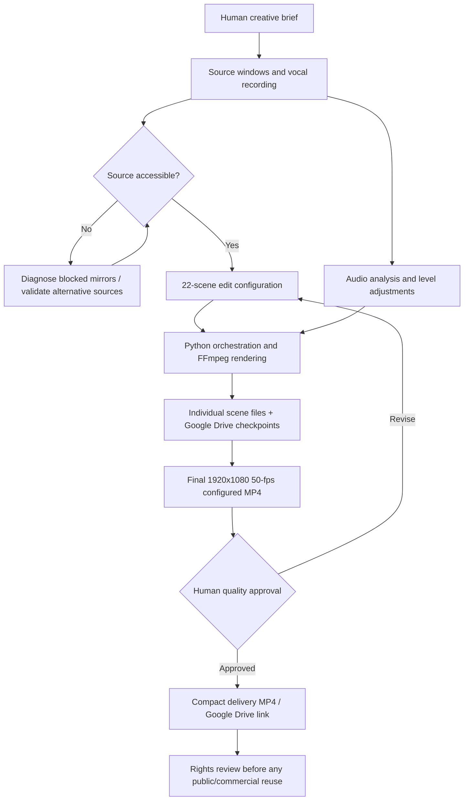

# Architecture and Quality Gates

## Actual personal-project workflow

## Component ownership

| Component | Responsibility |
| --- | --- |
| Project owner | Requirements, recording own vocals, selecting permissible clip windows, edit feedback, final QA |
| ChatGPT | AI assistance with storyboard, code, technical analysis and troubleshooting |
| Python | Orchestration, timeline preparation, file handling and scene jobs |
| FFmpeg | Rendering, clipping, scaling, overlays, audio and codec processing |
| Google Colab | CPU computational workspace for batch media processing |
| Google Drive | Checkpoints and final sharing |
| Human review | Creative approval, authenticity checking, subjective image/audio quality and permissions decisions |

## Acceptance checks

- Planned music timeline length approximately **157.368 s**.
- **15 user-approved source windows** across three video files, arranged into **22 timeline positions**.
- Final content includes the ship and Perfect Day at CocoCay, **not** Cozumel or Costa Maya.
- No personal portraits or generated likenesses of the singer.
- Approved text appearances near **0–3 s**, **24–32 s**, and **last 3 s**.
- Repair unwanted transitions/flashes and poor enlarged footage crops.
- Production output configured **1920×1080, H.264/AAC, 50 fps**.
- Final acceptance by project owner; independent file probing still desirable.

## Reliability and resource design

Original media sources were too large for repeated full downloads. The workflow used selective source-range access where the server supported HTTP Range requests. Scene rendering was checkpointed in Drive so later reruns could avoid recomputing successful scenes. **GPU T4 was unnecessary**; the workflow used Colab CPU and FFmpeg.

## Open risks

The available evidence does not prove native 50-fps source capture, measured final loudness, total costs, copyright clearance, or any official Royal Caribbean usage approval. A successful technical rendering job does not override those requirements.

[Portfolio summary](../README.md) · [Evidence](EVIDENCE.md)
