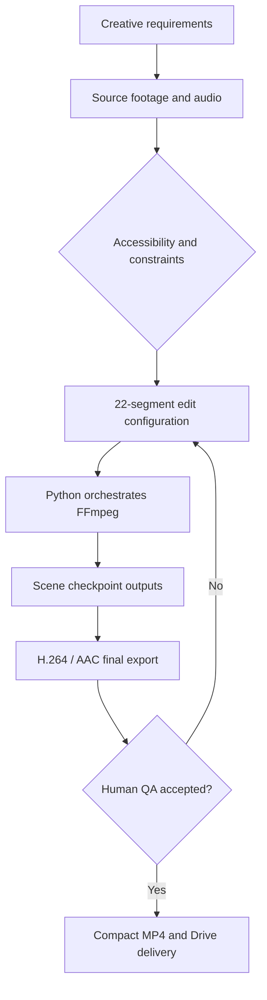

# Professional Case Study — AI-Assisted Video Production

**From a creative brief to a completed Full HD video through AI-assisted workflow design, Python/FFmpeg automation and human quality assurance.**

**Role:** Project owner, AI project manager, workflow designer, QA decision-maker  
**Project:** Independent *Legend of the Seas* personal music-video tribute, October 2026  
**Status:** Completed personally accepted prototype; no paid client, licensing clearance or official Royal Caribbean endorsement claimed

## Executive summary

I directed an end-to-end, AI-assisted workflow to create a personalized cruise music video from my own vocal recording and constrained, authentic visual footage. The production used ChatGPT for planning, script/configuration assistance and debugging, while Python and FFmpeg on Google Colab performed deterministic scene rendering, title overlays, audio handling and final encoding. I evaluated successive versions, adjusted requirements and approved the final video.

The result was an owner-accepted approximately **157-second Full HD / 50-fps** video assembled from a planned **22-segment timeline**. The owner reported that the final V5 render was successful and smoother than earlier versions; a compact approximately **140 MB** delivery file was made accessible through Google Drive.

## Challenge

The creative project had nontrivial operational constraints:
- Preserve the human vocal performance and synchronization with an existing song recording of **157.368 seconds**.
- Select footage only from **15 authorized time windows** of three large original press-center recordings.
- Show the intended ship and Perfect Day at CocoCay, without irrelevant destinations, sunset images or personal portraits.
- Control the placement of titles and brand references without generating fictitious ship imagery.
- Correct occasional visible flashes, poor crop sharpness, timing issues and jerky motion.
- Handle multi-gigabyte source files in a notebook environment with limited runtime.
- Provide a smaller, accessible version for recipients without losing the original high-quality file.

## Role and division of work

**Human owner:** creative brief and acceptance criteria, constraints and footage approval, personal vocal performance, review of every major version, selection of fixes, final sign-off and distribution decisions.

**ChatGPT:** AI-assisted planning, code drafting, problem decomposition, debugging and advice. AI neither chose the creative direction autonomously nor validated all footage rights.

**Python + FFmpeg:** clip extraction, concatenation, frame-rate configuration/conversion, title overlays, loudness processing, compression, and final MP4 export.

**Google Colab CPU:** compute environment; GPU T4 was not required for the chosen media transformation workflow.

**Google Drive:** per-scene checkpoints for reliability and a link for receiving the compact video.

## Process architecture

The source-window and final-quality checks were explicit gates. Rights review is separate from whether the video can be rendered successfully.

## Iterations: what changed and why

**Early drafts, including V3:** Fast adjustments were made using a lower-resolution video preview. The process repaired title placement and timing, moved footage to more appropriate sections, and removed unwanted visual inserts. This confirmed the edit concept but introduced quality constraints because the preview was already encoded at **960×540**.

**V4:** A **540p, 50-fps** preview explored improved motion continuity and removal of blurry zoomed crops. This did not restore native resolution or missing original frames. Output frame rate alone is not evidence that all frames are original.

**V5:** The approved timeline was rebuilt from selected **original video sources** to achieve the intended **1920×1080** export and configured **50 fps** output while retaining the user's recorded voice. Large workloads were divided into restartable scene renders with Drive checkpoints.

**Delivery iteration:** A compact H.264 MP4 made transfer/sharing easier. The owner noticed that in-browser playback through Google Drive looked somewhat softer/less smooth than the local file; recipients could download the original MP4 for optimal playback.

## Evidence and results

| Claim | Supported state |
| --- | --- |
| Rendered personal final video | **Confirmed by owner** |
| Perceived quality / smoothness improved | **Confirmed by owner's viewing**; subjective |
| Video length | **157.368 seconds planned**; final independent probe unavailable |
| Final export | **1920×1080, 50 fps configured**; machine-readable final file evidence not deposited |
| Timeline scale | **22 scenes; 15 footage source windows** documented |
| Compact transfer file | **Approximately 140 MB** reported by owner |
| Recipient sharing | Google Drive access confirmed by owner |
| Outreach | Royal Caribbean contacted; **company response unknown** |
| Manual time saved, production cost, ROI | **Not measured** |
| Music / press-video licenses | **Not confirmed** |

## Practical business and technical skills

- **Project management:** transform ambiguity into requirements, agreed scope and acceptance gates.
- **Process analysis:** sequence discrete stages, diagnose bottlenecks and introduce checkpoint-based recovery.
- **Technical orchestration:** combine AI-assisted development with deterministic FFmpeg transformations.
- **Quality assurance:** identify the limits of repeated lossy encoding and escalate to source-based rendering.
- **Responsible delivery:** record what was independently verified vs owner-reported or still unknown.

## What I would improve for a client deployment

Implement automatic `ffprobe` validation and file checksums after every render, record wall-clock and human labor hours, collect costs, add rights/consent metadata for each asset, create approval logs, and quantify repeatability across multiple projects.

## Commercial extension (proposal, not already built)

A focused service for SMEs could automatically create approved, on-brand social videos from client-owned photos/videos and verified product data. Test it first on rights-clean samples, then measure cost per approved video and paid interest before building a SaaS platform. See [Product Opportunity](PRODUCT_OPPORTUNITY.md).

## Professional profile summary

> **AI-Assisted Video Production & Workflow Automation — Project Lead.** Managed a complex 22-segment, source-constrained video workflow using ChatGPT, Python, FFmpeg and Google Colab. Led iterative quality improvements to a completed Full HD/50-fps personal project, implemented checkpoint-based processing and documented technical and media-rights risks. Human-in-the-loop automation, project delivery and process improvement.

**Disclaimer:** This is an independent fan project, not an assignment from Royal Caribbean; no corporation approval, broadcast license, financial benefit or paid customer outcome is claimed.

[Back to overview](../README.md) · [Architecture](ARCHITECTURE.md) · [Evidence ledger](EVIDENCE.md)
